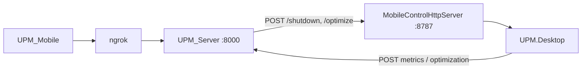

# UPM — Universal PC Manager

Windows PC의 하드웨어·리소스를 실시간으로 모니터링하고, 스마트 프로세스 최적화 및 모바일 원격 제어를 지원하는 **WPF 데스크톱** 프로젝트입니다.

---

## 주요 기능

- **실시간 모니터**: CPU · 메모리 · GPU 사용률(%) 도넛 게이지(LiveChartsCore) 및 GPU 온도계 시각화
- **시스템 사양 & 메모리 상위**: CPU/GPU(NVIDIA·AMD·Intel)/RAM/메인보드 상세 사양과 RAM 점유 상위 8개 프로세스 그룹(아이콘·점유율·개별 종료) 표시
- **빠른 최적화 (자동 / 선택 종료 모드)**:
  - **자동 종료 모드**: 서버 분석(`AnalyzeOptimizationAsync`) 기반 스마트 정리, 서버 미연결 시 로컬 안전 폴백(사용자 세션 비필수 고메모리 프로세스 선별 정리)
  - **선택 종료 모드**: 사용자가 체크한 프로세스 그룹만 안전하게 일괄 종료
- **화이트리스트 (종료 제외 목록)**: 실행 중인 프로세스(열린 윈도우 / 백그라운드 탭)에서 선택하거나 직접 입력해 보호 등록 (`%LocalAppData%\UPM\whitelist.json` 로컬 영속화 + 서버 DB 동기화)
- **다크 / 라이트 테마 전환**: 런타임 팔레트 교체(`Themes/Dark.xaml`, `Themes/Light.xaml`), Windows DWM 다크 타이틀바 연동 및 설정 자동 저장(`%LocalAppData%\UPM\settings.json`)
- **모바일 원격 제어 수신**: 로컬 HTTP 서버(`127.0.0.1:8787`)를 통해 모바일 앱의 PC 종료(`/shutdown`) 및 최적화(`/optimize`) 명령 수신

---

## 화면 구성

| 구역 | 설명 |
|:---:|:---|
| **상단 헤더** | UPM 애니메이션 로고 + **테마 전환(다크/라이트)** · **화이트리스트** · **빠른 최적화** 버튼 |
| **중단 패널** | **실시간 모니터** — CPU / 메모리 / GPU 사용률 도넛 차트 & GPU 온도계 |
| **하단 패널** | **하드웨어 및 메모리** (`자세히 보기` 토글) — 좌측 시스템 사양 테이블 / 우측 메모리 상위 프로세스 제어 (`자동 종료 모드` ↔ `선택 종료 모드`) |

---

## APIs

클라이언트가 호출·수신하는 REST 경로와 페이로드 요약은 아래 문서에 정리했습니다.

👉 [APIs.md](./APIs.md) 바로보기

| 메서드 | 경로 | 클라이언트 메서드 | 설명 |
|:---|:---|:---|:---|
| `POST` | `/api/v1/metrics` | `SendSystemStatusAsync` | 5초 주기로 시스템 상태 및 상위 프로세스 전송 |
| `POST` | `/api/v1/optimization/analyze` | `AnalyzeOptimizationAsync` | `machineId`·프로세스 목록 전송 → 종료 대상 `killList` 수신 |
| `POST` | `/api/v1/optimization/report` | `ReportOptimizationAsync` | 실제 종료된 프로세스 목록 보고 |
| `GET` | `/api/v1/optimization/exceptions` | `GetUserExceptionsAsync` | 머신의 화이트리스트(예외) 목록 조회 |
| `POST` | `/api/v1/optimization/exceptions` | `UpdateUserExceptionAsync` | 예외 프로세스 추가(`add`) 또는 제거(`remove`) |

---

## 기술 스택

### Desktop / Runtime

| 구분 | 기술 |
|:---|:---|
| 언어 / 런타임 | C# 12, **.NET 8** |
| UI | **WPF** (`WpfAnimatedGif` 포함) |
| 대상 OS | **Windows 10 1809 이상** (`net8.0-windows10.0.19041.0`) |
| 차트 | **LiveChartsCore.SkiaSharpView.WPF** 2.0.x |
| 모니터링 | **LibreHardwareMonitorLib**, `System.Management`(WMI), `PerformanceCounter` |

### 솔루션 구조

| 경로 | 프로젝트 | 역할 |
|:---|:---|:---|
| `Apps/UPM.Desktop/` | `UPM.Desktop` | WPF 앱, 다크/라이트 테마(`ThemeManager`), 뷰모델(`DashboardViewModel`), 컨버터 |
| `Libraries/UPM.Core/` | `UPM.Core` | `HardwareMonitor`, `LocalWhitelistStore`, `MobileControlHttpServer`, `SystemPowerController`, `UpmAppSettings` |
| `Libraries/UPM.Communication/` | `UPM.Communication` | FastAPI 서버 통신 `ApiServerClient` |
| `Shared/UPM.Models/` | `UPM.Models` | `SystemStatusModel`, `ProcessInfoModel`, `HardwareSpecModel` |

---

## 프로젝트 아키텍처



---

## 시작하기

### 사전 요구 사항

- Windows 10 1809 이상
- [.NET 8 SDK](https://dotnet.microsoft.com/download/dotnet/8.0)

### 빌드 및 실행

```powershell
dotnet build UPM.sln -c Release
dotnet run --project Apps/UPM.Desktop/UPM.Desktop.csproj
```

### 단일 실행 파일(Single-File) 배포

```powershell
dotnet publish Apps/UPM.Desktop/UPM.Desktop.csproj -p:PublishProfile=SingleFile-win-x64
```
- 결과물: `Apps/UPM.Desktop/bin/publish/win-x64/UPM.Desktop.exe` (.NET 런타임 별도 설치 불필요)

### 설정 변경

`Libraries/UPM.Core/UpmAppSettings.cs`:

```csharp
public const string MetricsServerBaseUrl = "http://localhost:8000";
public const int MobileControlPort = 8787;
```

---

## 프로젝트 팀원

| 역할 | 비고 |
|:---:|:---|
| Maintainer | [@Dungsu](https://github.com/Dungsu) |
